## Building the Project

I first setup the app locally on my machine and containerised the app using Docker.

I then pushed the built image to both AWS and Docker.

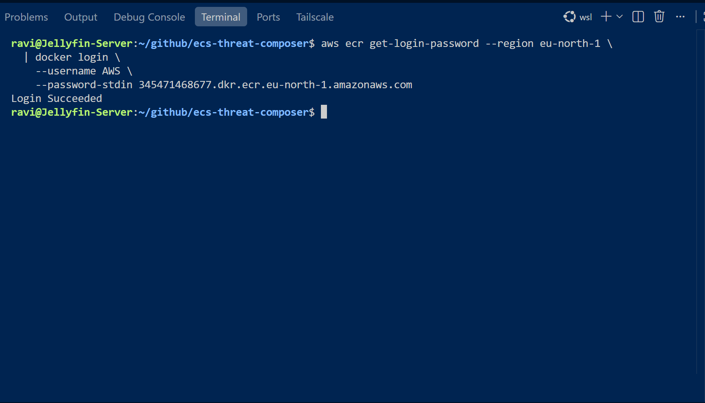

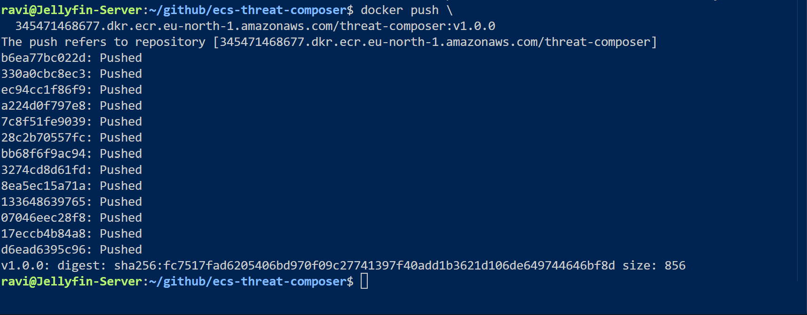

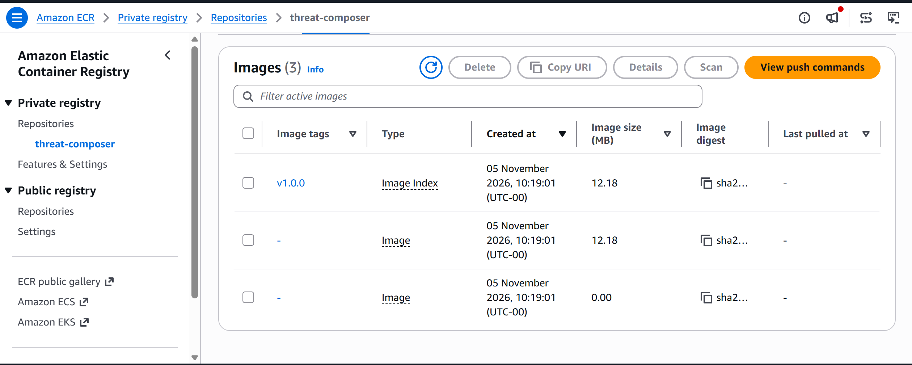

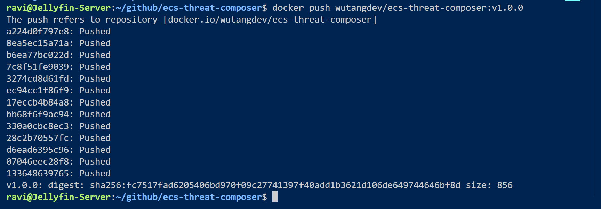

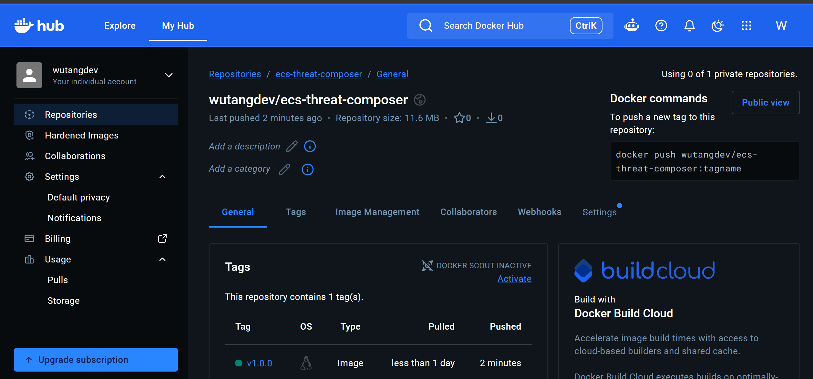

I then built the AWS infrastructure. Before moving onto Terraform, I built in the AWS Console to understand what I am building.

### Create an ECR repository

### Create an ECS Cluster

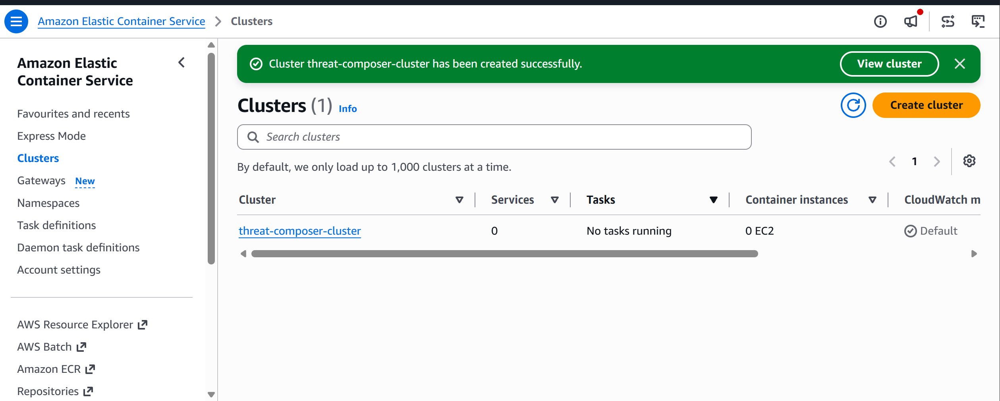

### Create a Task Definition for My Container

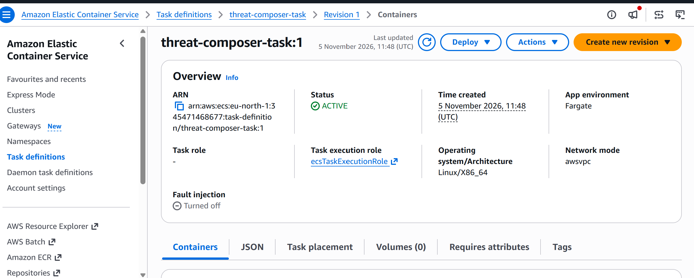

### Create VPC

| Setting | Value |
|---|---|
| Name tag auto-generation | threat-composer |
| IPv4 CIDR block | 10.0.0.0/16 |
| IPv6 CIDR block | No IPv6 |
| Tenancy | Default |
| Number of Availability Zones | 2 |
| Number of public subnets | 2 |
| Number of private subnets | 2 |
| NAT gateways | 1 in 1 AZ |
| VPC endpoints | None for now |
| DNS hostnames | Enabled |
| DNS resolution | Enabled |

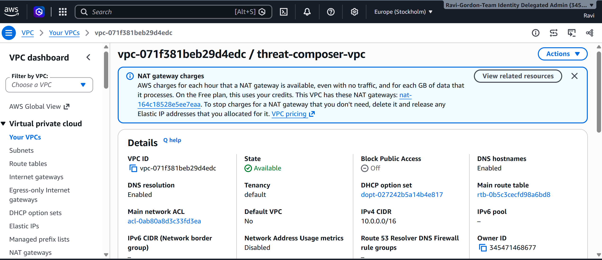

### Create Security Groups

threat composer alb security group inbound rules 

threat composer ecs security group inbound rules

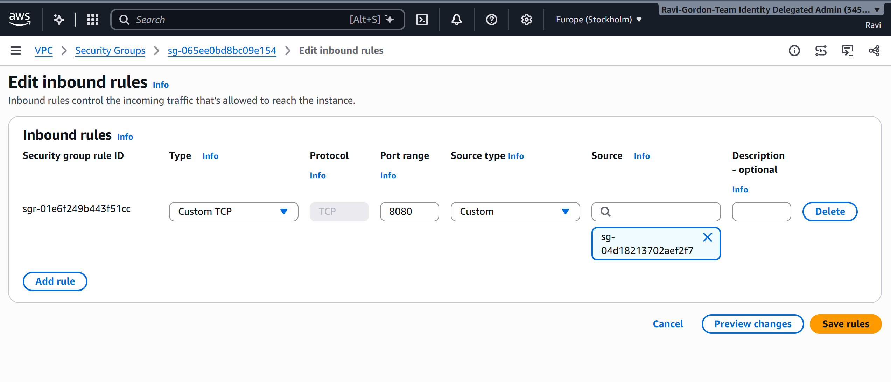 

### Create Application Load Balancer (ALB)

ALB target group

Application Load Balancer

I initially configured the Application Load Balancer with an HTTP listener on port 80 to test the ECS Fargate deployment. Once the application is running successfully, I will add an HTTPS listener on port 443 using an AWS Certificate Manager (ACM) certificate and configure HTTP-to-HTTPS redirection.

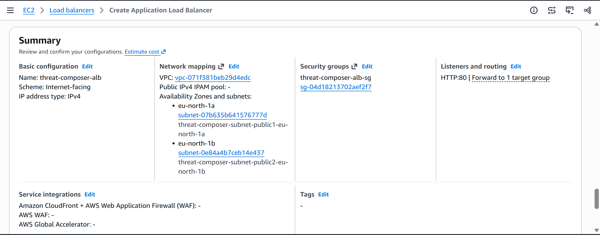

### Create the ECS Fargate service

Container: threat-composer 

Port Mapping 

### Verify the Application Load Balancer

confirmed the ALB can successfully reach NGINX

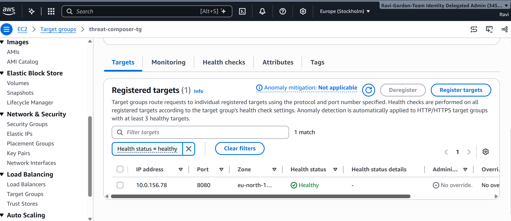

tested in my browser using the DNS Name from the ALB

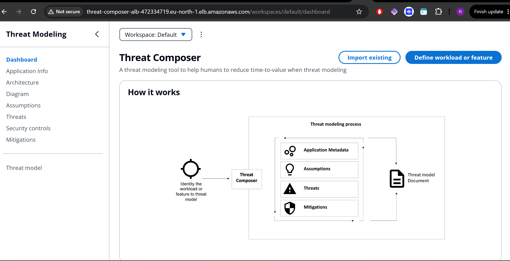

### Route 53 record

request  SSL/TLS certificate

Added HTTPS to the ALB security group 

Added the HTTPS listener 

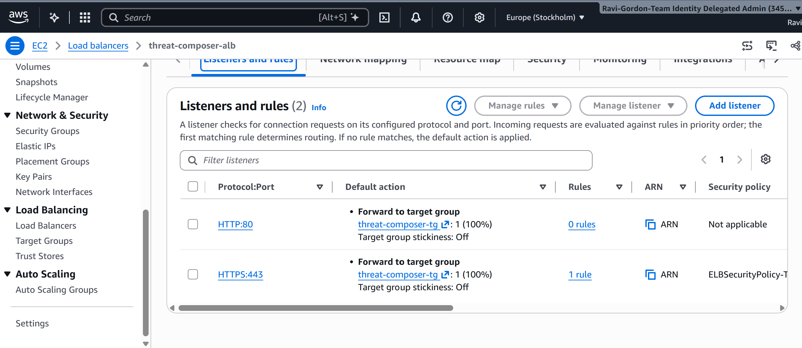

Redirect HTTP to HTTPS

Route 53 and create an A alias record

Tested in my Terminal 

Browser Check displaying https://tm.rginfralabs.co.uk/workspaces/default/dashboard

