## Building the Project

I first setup the app locally on my machine and containerised the app using Docker.

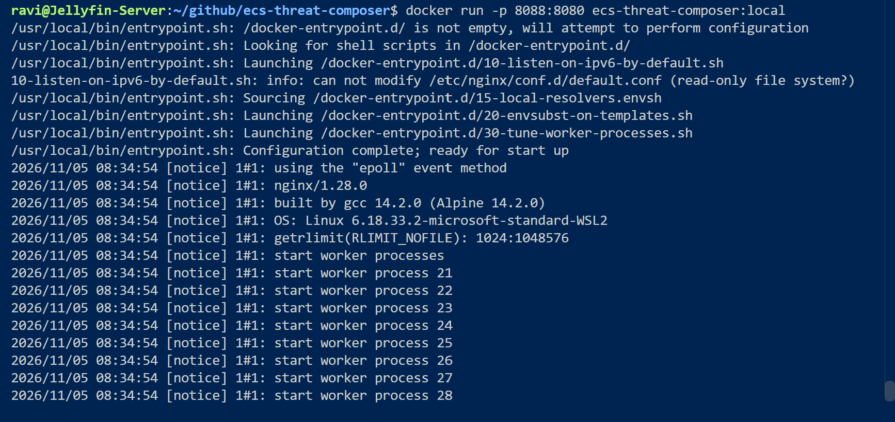

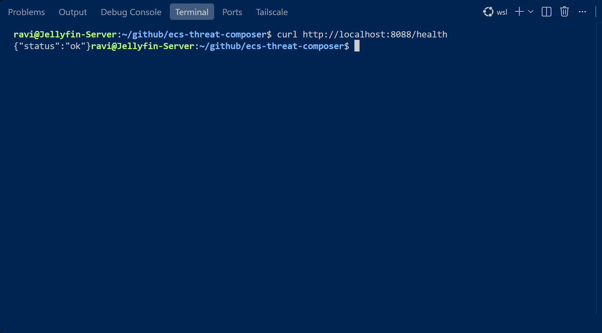

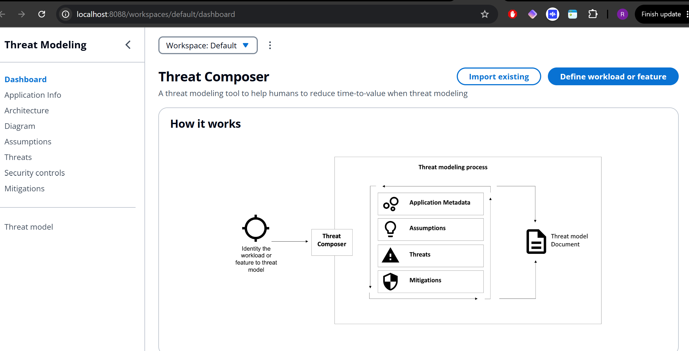

I then pushed the built image to both AWS and Docker.

I then built the AWS infrastructure. Before moving onto Terraform, I built in the AWS Console to understand what I am building.

### Create an ECR repository
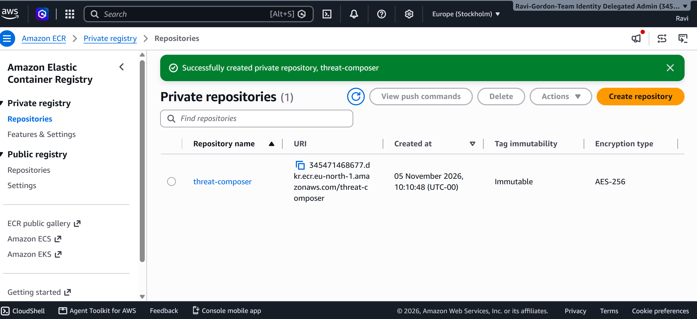

### Create an ECS Cluster

### Create a Task Definition for My Container

### Create VPC

| Setting | Value |
|---|---|
| Name tag auto-generation | threat-composer |
| IPv4 CIDR block | 10.0.0.0/16 |
| IPv6 CIDR block | No IPv6 |
| Tenancy | Default |
| Number of Availability Zones | 2 |
| Number of public subnets | 2 |
| Number of private subnets | 2 |
| NAT gateways | 1 in 1 AZ |
| VPC endpoints | None for now |
| DNS hostnames | Enabled |
| DNS resolution | Enabled |

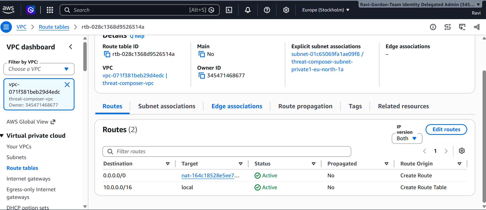

### Create Security Groups

threat composer alb security group inbound rules 

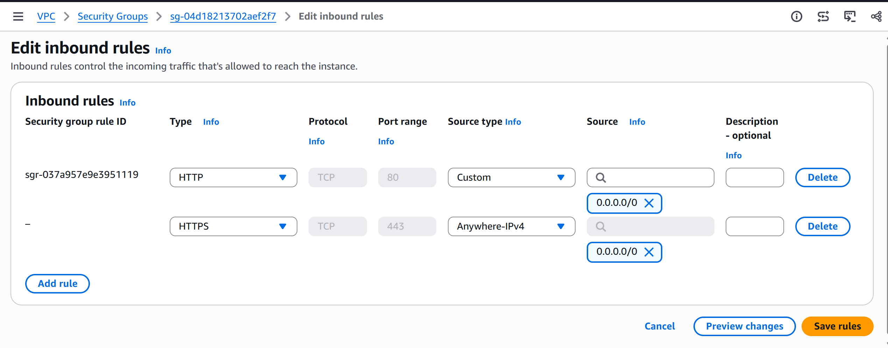

threat composer ecs security group inbound rules

 

### Create Application Load Balancer (ALB)

ALB target group

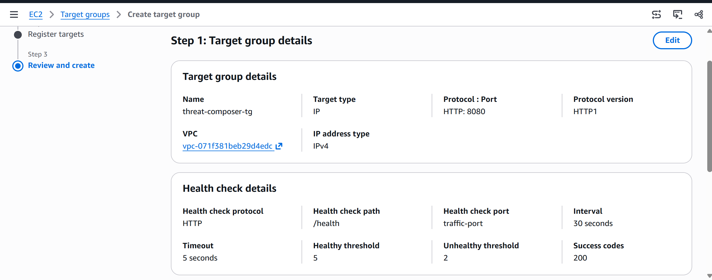

Application Load Balancer

I initially configured the Application Load Balancer with an HTTP listener on port 80 to test the ECS Fargate deployment. Once the application is running successfully, I will add an HTTPS listener on port 443 using an AWS Certificate Manager (ACM) certificate and configure HTTP-to-HTTPS redirection.

### Create the ECS Fargate service

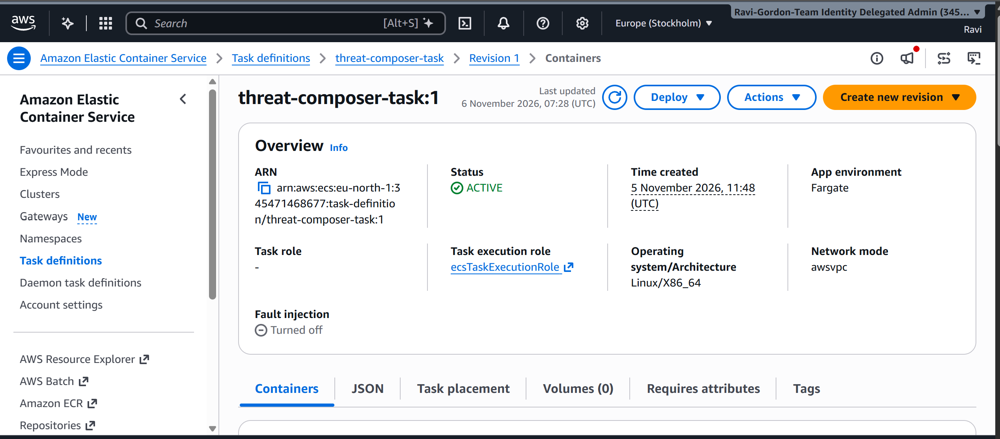

Container: threat-composer 

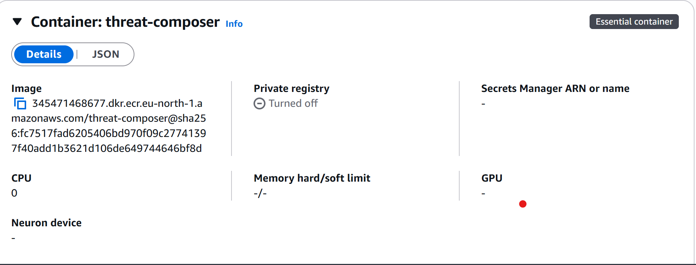

Port Mapping 

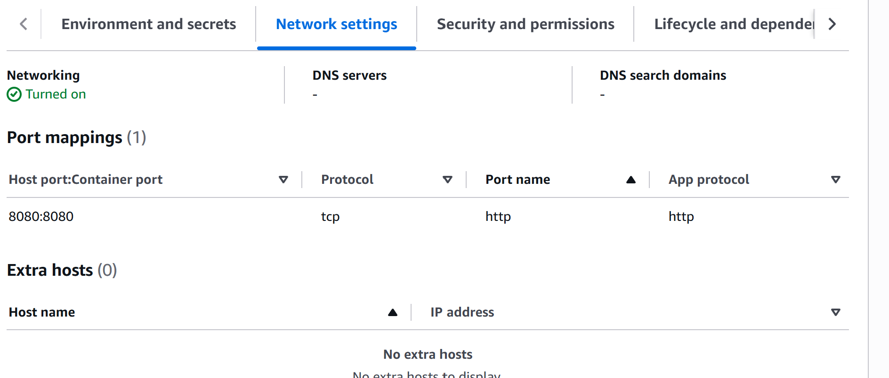

### Verify the Application Load Balancer

confirmed the ALB can successfully reach NGINX

tested in my browser using the DNS Name from the ALB

### Route 53 record

request  SSL/TLS certificate

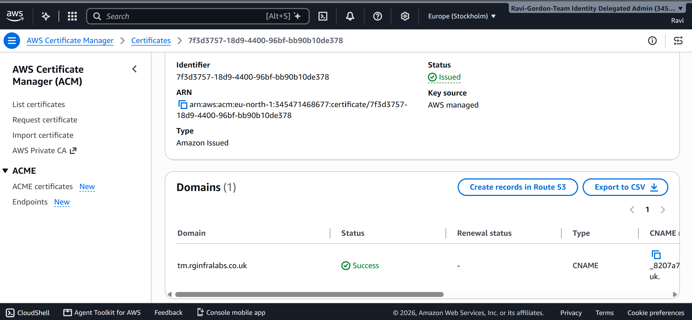

Added HTTPS to the ALB security group 

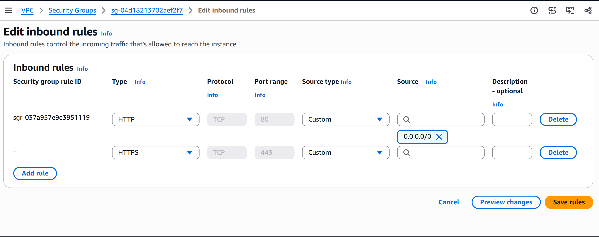

Added the HTTPS listener 

Redirect HTTP to HTTPS

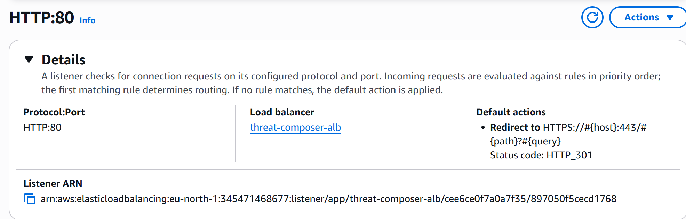

Route 53 and create an A alias record

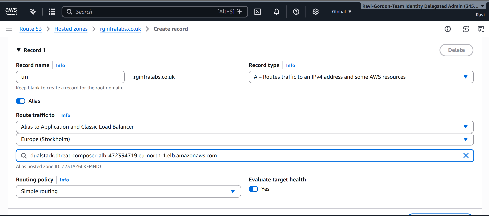

Tested in my Terminal 

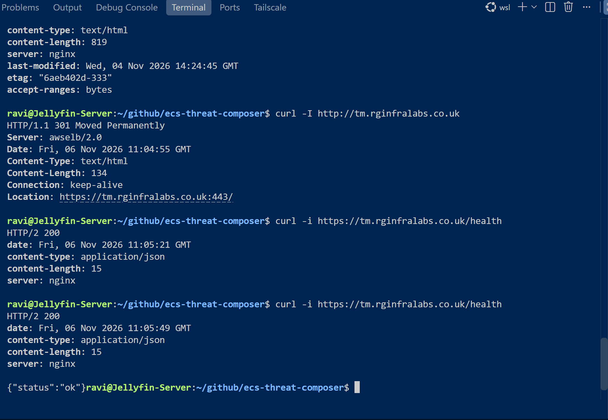

Browser Check displaying https://tm.rginfralabs.co.uk/workspaces/default/dashboard

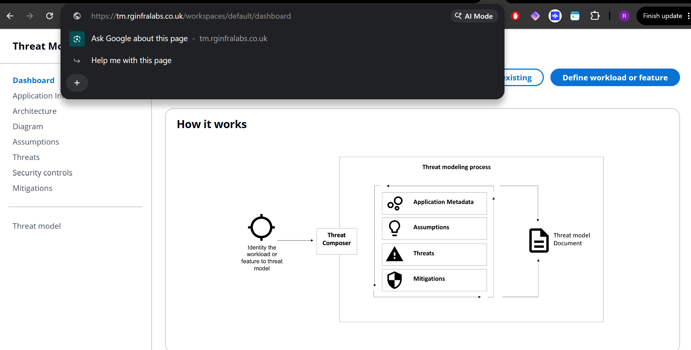

## Terraform 

I then rebuiilt the infrastructure in Terraform . I first built the provider.tf and created a variable for the region 

### Provider

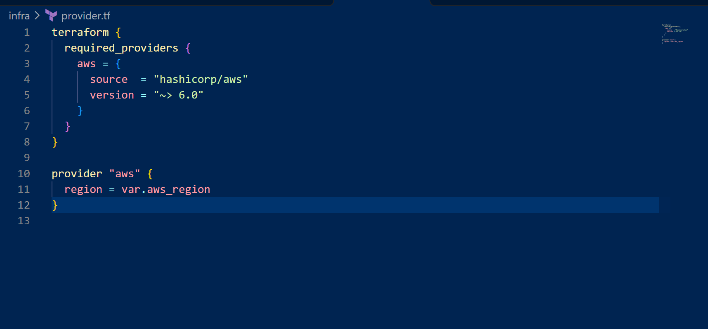

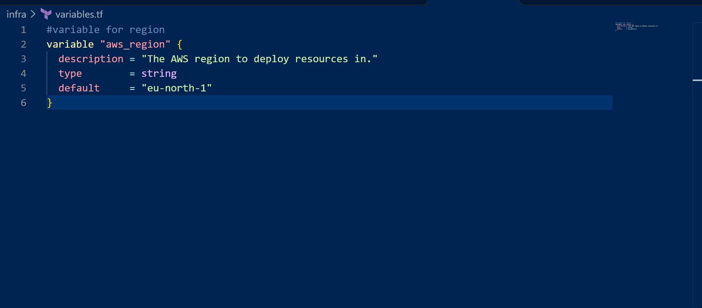

I then Initialise Terraform , Ran Terraform Format and Validate

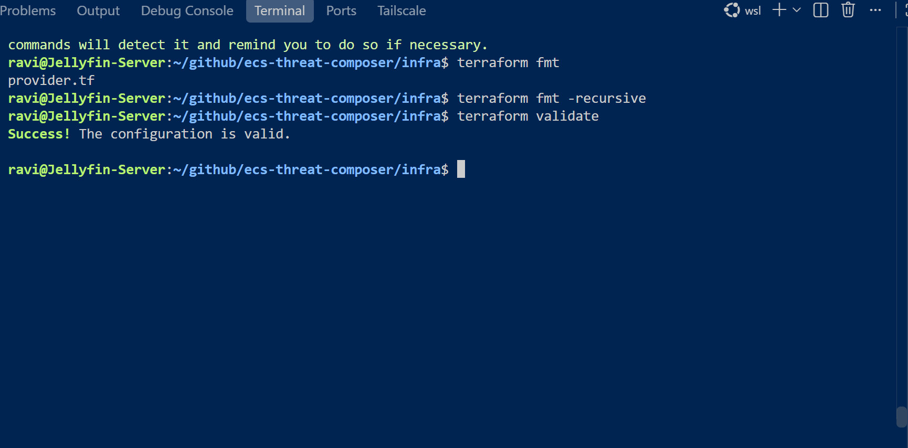

### VPC 
I then built the VPC module 

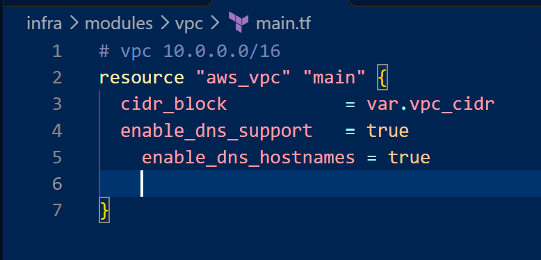

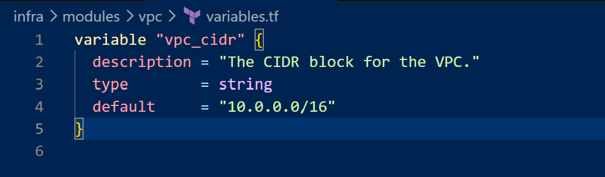

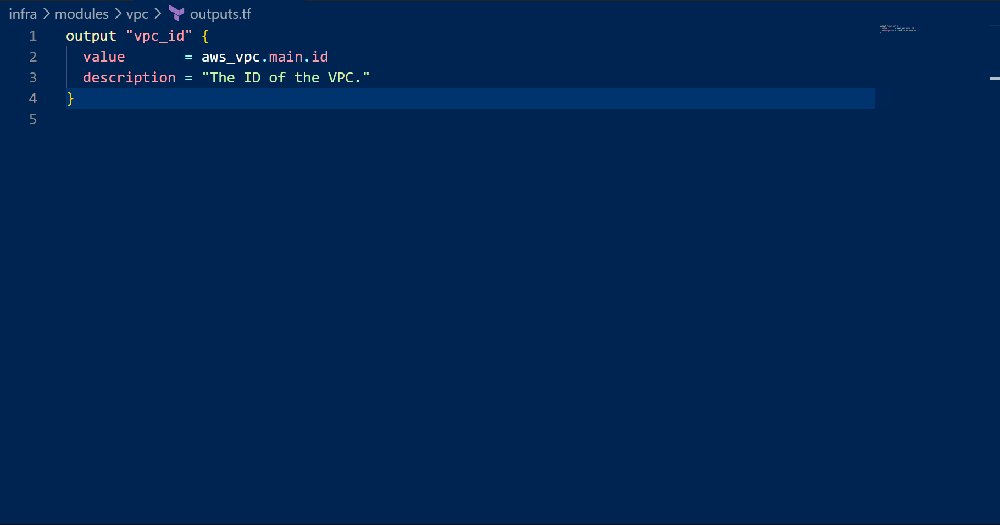

I then connected the VPC module to my root main.tf 