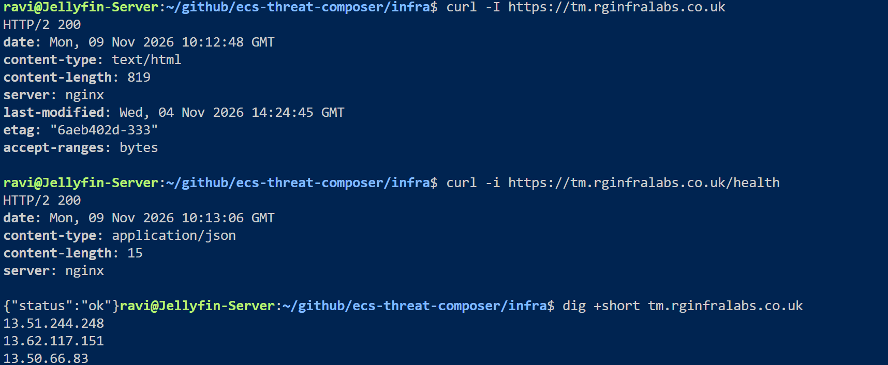
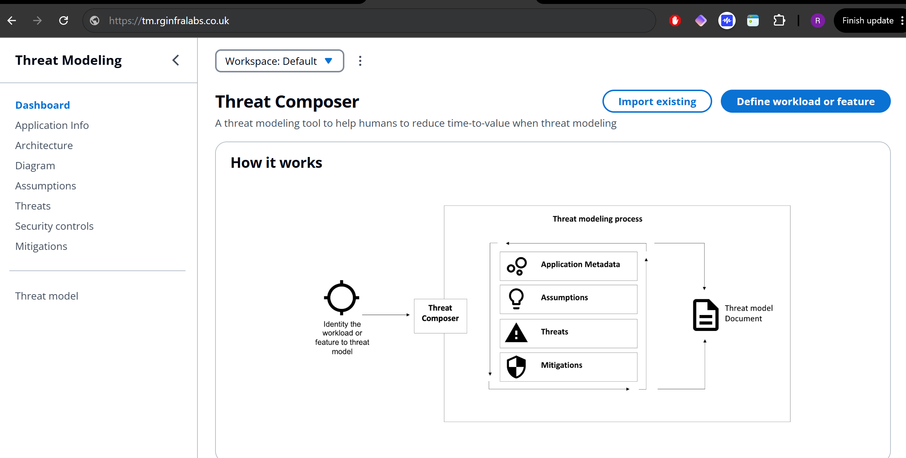
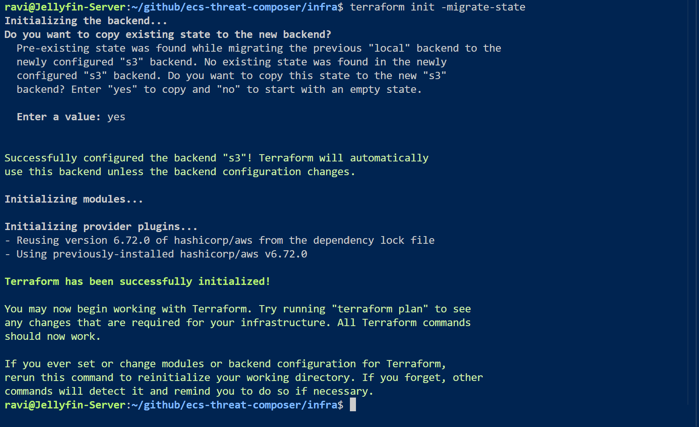
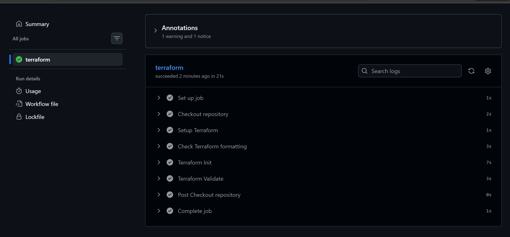
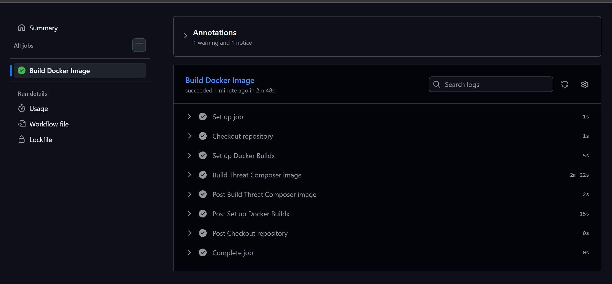
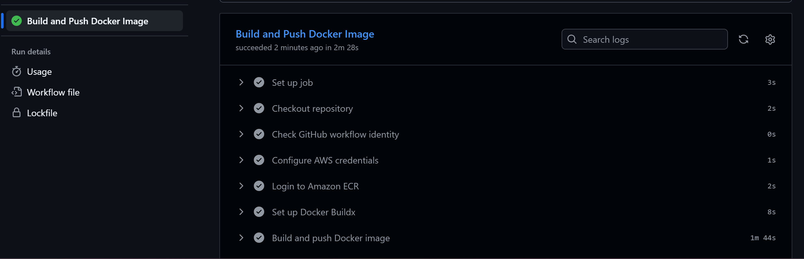
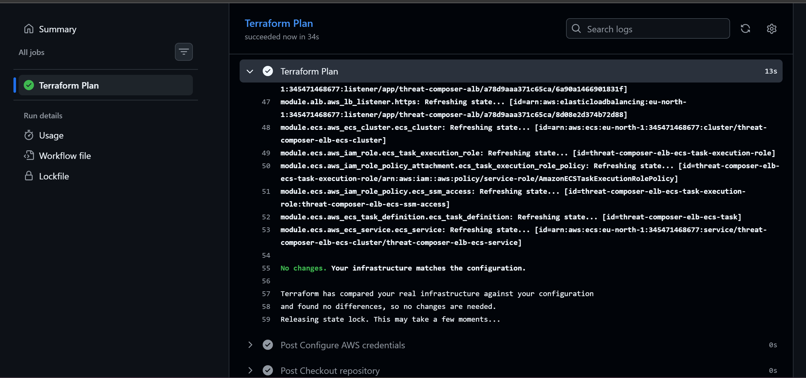
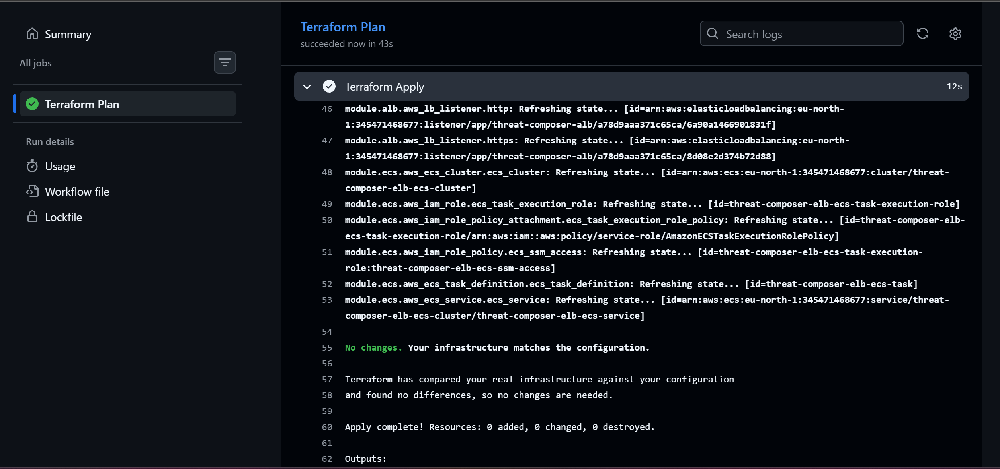
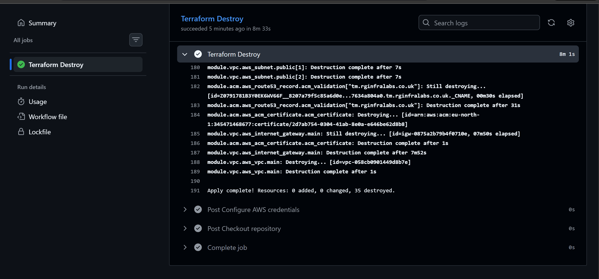

# ECS Threat Composer

## Objective

Build, containerise and deploy an application using Docker, Terraform, and ECS, with HTTPS and a custom domain.Demonstarting a production workflow

## Project Overview

This project involves containerising Threat Composer, a React-based threat modelling application, and deploying it to AWS ECS Fargate.

I used a multi-stage Dockerfile to build the application and NGINX to serve the static files, handle React routing and provide a `/health` endpoint.

The container image was pushed to Amazon ECR and deployed using ECS Fargate, an Application Load Balancer, Route 53 and ACM for HTTPS.

I first built the infrastructure manually using the AWS Console before recreating it with Terraform and automating deployments using GitHub Actions.

**Build documentation showing how I built the project:** [BUILD.md](BUILD.md) - in order of how I tackled the project from deploying locally to building in the AWS Console 

## NGINX Configuration

I used NGINX as the web server for my containerised Threat Composer application. After building the React application using a multi-stage Dockerfile, NGINX serves the static files on port 8080, handles React client-side routing and provides a `/health` endpoint for AWS Application Load Balancer health checks, ensuring the container is responding correctly.

## Terraform Networking

I used Terraform to recreate the AWS networking infrastructure I initially built manually using the AWS Console.

I created a custom VPC (`10.0.0.0/16`) with three public and three private subnets across three Availability Zones.

I configured an Internet Gateway, public route tables, a NAT Gateway with an Elastic IP, and private routing to provide outbound internet access.

I organised the configuration into a reusable VPC module using variables and outputs, allowing me to manage and deploy the networking infrastructure consistently through Infrastructure as Code (IaC).

## Application Load Balancer Deployment Using Terraform

I used Terraform to deploy an internet-facing Application Load Balancer across three public subnets, connecting it to my existing VPC and security groups.

I configured a target group on port 8080, an HTTP listener to redirect traffic to HTTPS, and an HTTPS listener using my existing AWS ACM certificate.

I used `terraform.tfvars` to supply the ACM certificate ARN without hardcoding it into my configuration or exposing it on GitHub.

Both listeners were successfully deployed and verified using `terraform apply`.

## ECS Fargate Deployment

I used Terraform to provision an ECS cluster, task definition and Fargate service to deploy my containerised Threat Composer application. The service pulls the Docker image from Amazon ECR and runs one task within a private subnet without a public IP address. I configured security groups to allow traffic from the Application Load Balancer on port 8080. I then verified the ECS service reached a steady state and confirmed the ALB target group reported the container as healthy.

## Route 53 and ACM Configuration

I used Terraform to automate DNS configuration and HTTPS certificate management. I created an ACM module to request and validate a certificate for `tm.rginfralabs.co.uk` using Route 53 DNS validation. I then created a Route 53 A alias record pointing the subdomain to my Application Load Balancer. Finally, I verified DNS resolution using `dig` and tested the application and `/health` endpoint using `curl`. Both returned HTTP/2 200, confirming successful HTTPS connectivity.

## validation checks

terminal validation checks for deployment

Browser validation showing HTTPS

## AWS Systems Manager Parameter Store (Bonus)

I used Terraform to create an AWS Systems Manager Parameter Store module to manage application configuration.

I stored the application environment (`production`) as a String parameter and configured the ECS task definition to retrieve it as the `APP_ENV` environment variable.

I also created an IAM policy granting the ECS task execution role permission to retrieve the specific parameter.

I verified the parameter using AWS CLI, confirmed the updated ECS task was running, and tested the HTTPS health endpoint successfully.

## S3 Remote Backend and State Locking

I created an S3 bucket to store my Terraform state remotely. I enabled versioning, AES-256 encryption and blocked public access. I configured native S3 state locking using `use_lockfile = true`, then migrated my existing local state using `terraform init -migrate-state`. I verified the migration and confirmed Terraform reported no infrastructure changes.

## 6. CI/CD Automation

#### Terraform Checks Pipeline

I created a GitHub Actions workflow to automatically check my Terraform configuration on pushes and pull requests to `main`, with manual execution also available. The pipeline runs Terraform formatting, initialisation and validation checks. I verified all checks passed successfully.

### Application CI Pipeline – Docker Build

I created a GitHub Actions workflow to automatically build my Threat Composer Docker image when application changes are pushed to `main`. The pipeline uses Docker Buildx and tags the image with the Git commit SHA. I verified that the workflow completed successfully before adding ECR deployment.

### Application CI/CD Pipeline – Docker Build and ECR Push

I created a GitHub Actions pipeline to automatically build and push my Threat Composer Docker image to Amazon ECR. I configured AWS OIDC authentication using Terraform, allowing GitHub Actions to access AWS without storing access keys. Each image is tagged using its Git commit SHA.

### Terraform Plan Pipeline

I created a GitHub Actions workflow to validate my existing AWS infrastructure using Terraform. The pipeline authenticates through GitHub OIDC, accesses my S3 remote state and runs `terraform plan`. The workflow completed successfully and confirmed that my deployed infrastructure matches the Terraform configuration, with no changes required.

### Terraform Deployment Pipeline

I extended my Terraform GitHub Actions workflow to include `terraform apply`. The pipeline authenticates with AWS using OIDC, accesses my S3 remote state and validates the infrastructure before applying the configuration. The workflow completed successfully, confirming that my existing AWS resources remained unchanged.

### Terraform Destroy Pipeline

I extended my Terraform GitHub Actions workflow to include `terraform destroy`. The pipeline authenticates with AWS using OIDC, accesses my S3 remote state and generates a destroy plan before deleting infrastructure following manual confirmation. The workflow completed successfully, destroying **35 AWS resources** in **8 minutes and 33 seconds**.

**Application:** https://tm.rginfralabs.co.uk (App Currently Destroyed to save costs)

