# ECS Threat Composer

## Objective

Build, containerise and deploy an application using Docker, Terraform, and ECS, with HTTPS and a custom domain – exactly like a real production workload.

## Building the Project

I first setup the app locally on my machine and containerised the app using Docker.

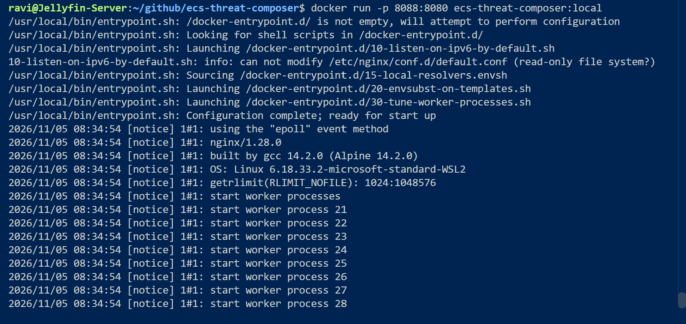

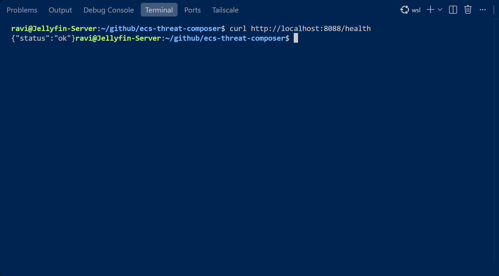

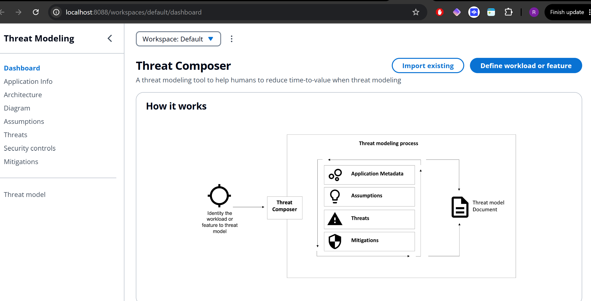

I then pushed the built image to both AWS and Docker.

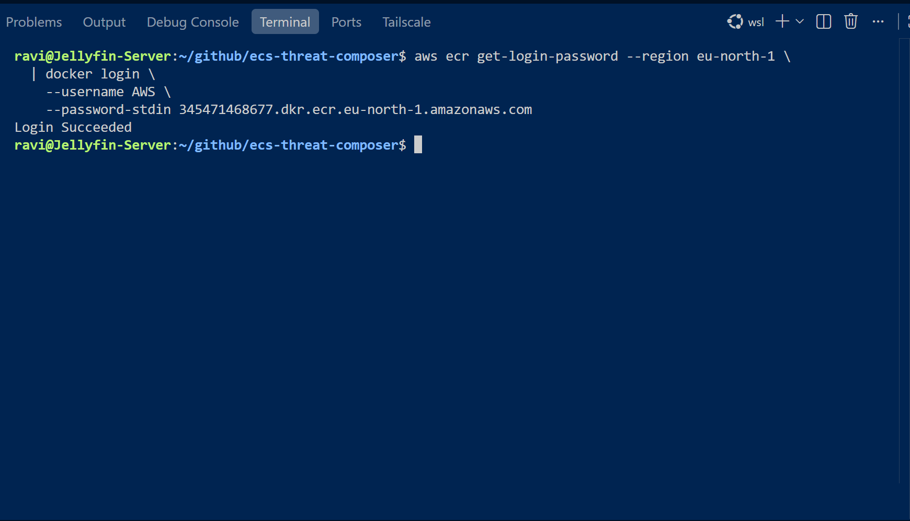

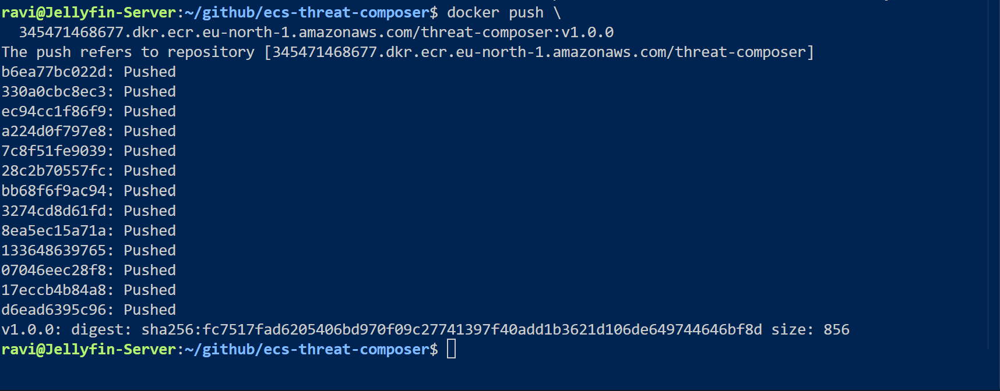

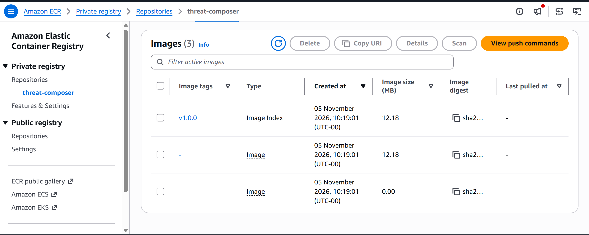

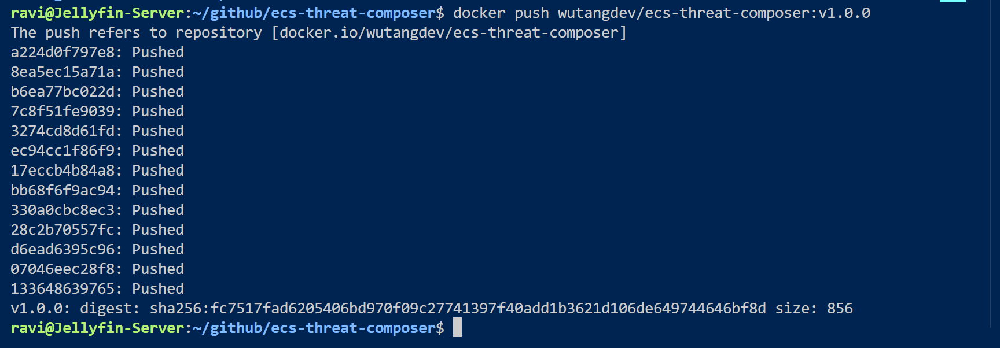

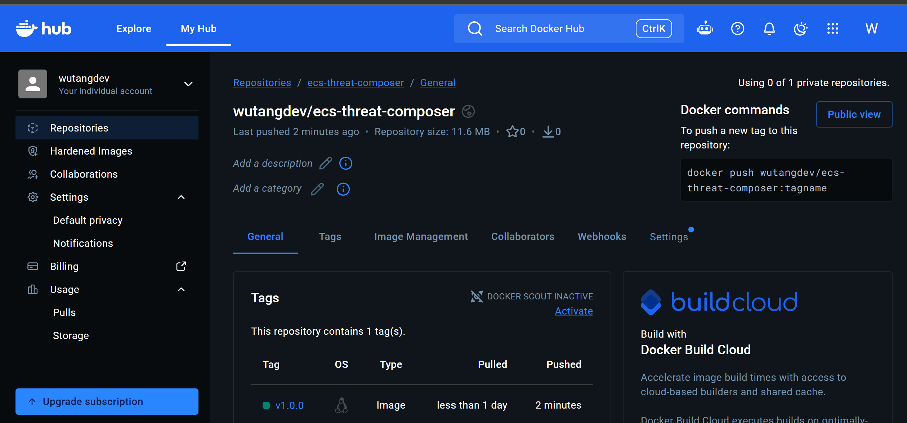

I then built the AWS infrastructure. Before moving onto Terraform, I built in the AWS Console to understand what I am building.

### Create an ECR repository
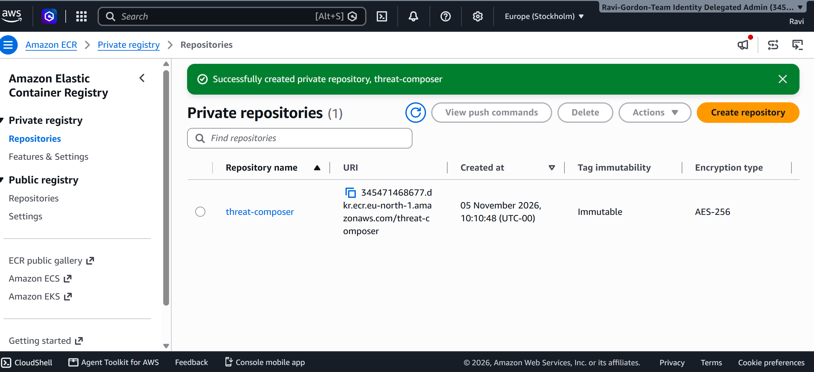

### Create an ECS Cluster

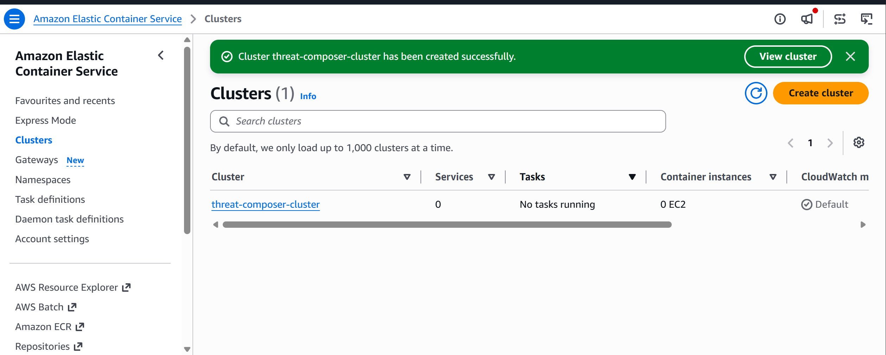

### Create a Task Definition for My Container

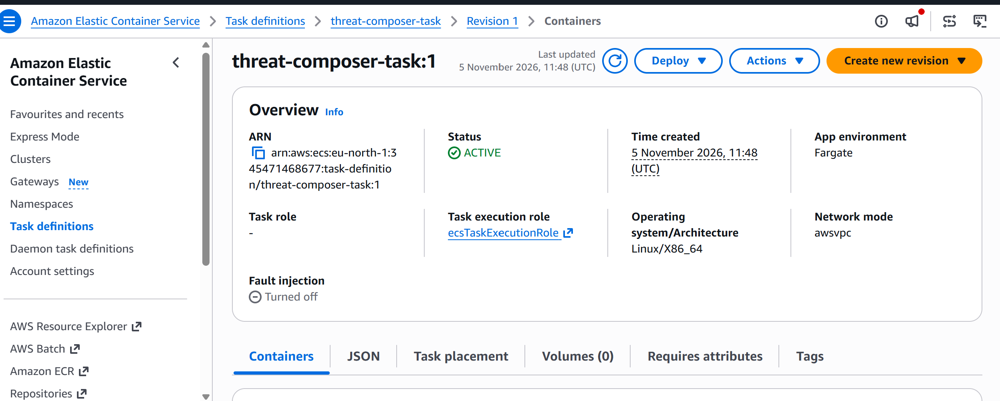

### Create VPC

| Setting | Value |
|---|---|
| Name tag auto-generation | threat-composer |
| IPv4 CIDR block | 10.0.0.0/16 |
| IPv6 CIDR block | No IPv6 |
| Tenancy | Default |
| Number of Availability Zones | 2 |
| Number of public subnets | 2 |
| Number of private subnets | 2 |
| NAT gateways | 1 in 1 AZ |
| VPC endpoints | None for now |
| DNS hostnames | Enabled |
| DNS resolution | Enabled |

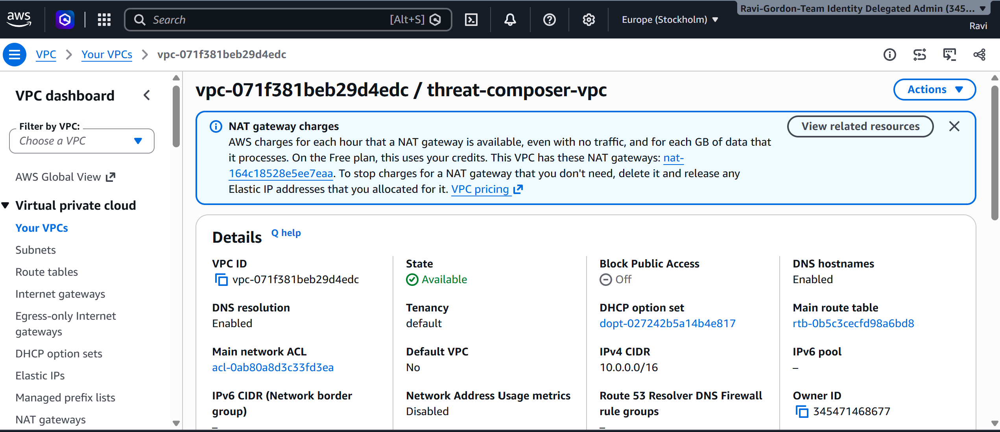

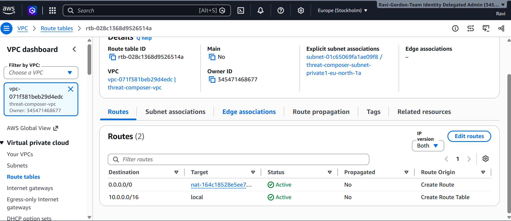